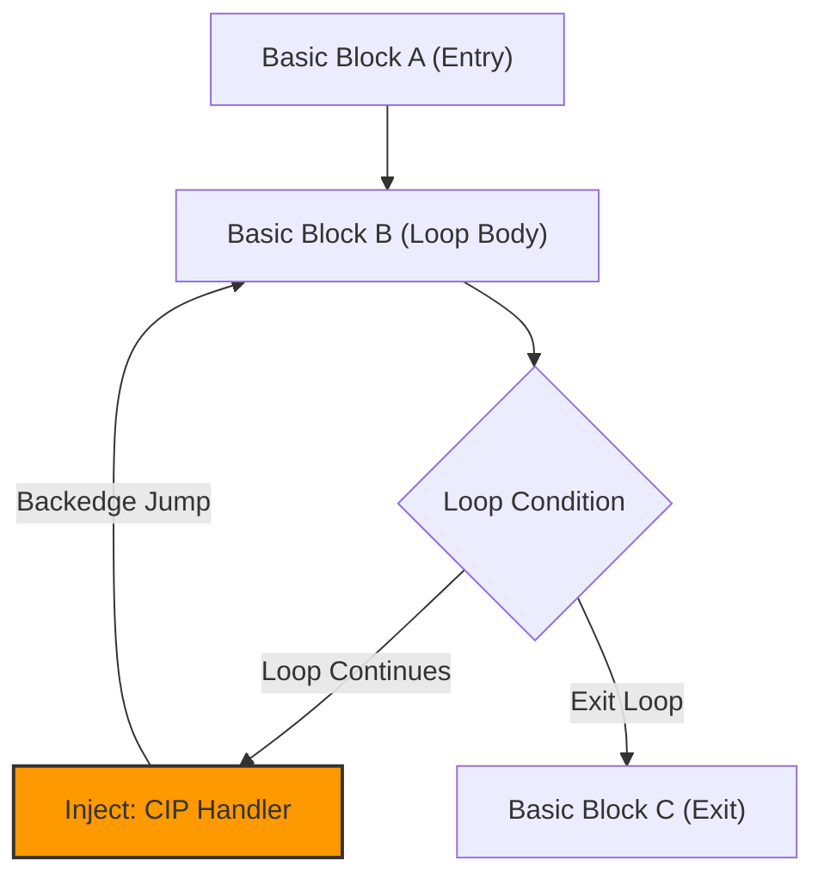

# Fanta ISA: Cooperative Interrupt Design & Compiler Spec

This document details the cooperative interrupt model for the Fanta 32-bit RISC machine: the instruction encoding, how programs register handlers, where the compiler injects checks, and the language constructs planned on top.

`CIP` is a **user-level event mechanism**. It is not the CPU's hardware interrupt path. A program states which events it handles and with which functions, and those handlers run only at safe points the program (or compiler) chooses. Kernel-level traps (syscalls, faults, preemptive interrupts) are a separate layer, covered in `docs/interrupts_proposal.md`. The two layers share only the *pending* bits (§6).

The guarantee this layer makes is about **when a program's own handlers run**, never about whether the CPU is interrupted: under an OS, the kernel can still preempt user code at any instruction, and user code cannot prevent that.

**Status by section:** §1–§6 are the agreed spec. §7 is the migration from today's implementation. §8 is agreed direction with open decisions (TODO). Surface syntax throughout is a placeholder.

---

## 1. Instruction Specification: `CIP`

The **`CIP`** (Call if Interrupt Pending) instruction cooperatively checks whether a given interrupt line (such as VBLANK) is pending, and if so calls the handler encoded in the instruction.

*   **Opcode**: `0x1F`
*   **Encoding**: the 26-bit payload carries both the line to check and the handler to call:
    ```
    [31:26] opcode 0x1F | [25:22] line (0-15) | [21:0] signed word offset to the handler
    ```
    The offset is in instructions, not bytes (`offset << 2`). Instructions are 4-byte aligned, so this is lossless, and it gives ±8 MB of reach, which covers all of RAM below VRAM.
*   **Assembler syntax**: `CIP #line, LABEL`, e.g. `CIP #0, GAME_VBLANK_ISR`.
*   **Behavior (Pseudocode)**:
    ```cpp
    auto line   = (inst >> 22) & 0xF;
    auto offset = signExtend22(inst & 0x3FFFFF) << 2;   // bytes, PC-relative

    if (cpu.cip_interrupts[line] == 1) {
        cpu.cip_interrupts[line] = 0;   // Clear the pending interrupt
        cpu.push_stack();               // Save PC so RET returns to the check site
        cpu.set_pc(cpu.get_prev_pc() + offset);
    }
    ```
*   **Handlers are ordinary functions** that end in `RET`. `CIP` is a call made at a point the program chose, so the CPU does not save flags. Saving whatever is live is the caller's job (see §4, injection rules, and the live-register argument in `docs/low_latency_architecture.md` §1).

---

## 2. Registering Handlers

Registration happens in the language and is **resolved at compile time**. There is no handler table in memory and no indirect jump. The compiler keeps the table of which function handles which event in each context, and encodes the chosen handler directly in each `CIP` it emits. This follows the static-dispatch direction in `docs/low_latency_architecture.md`.

Surface syntax (from `docs/low_latency_architecture.md` §1; placeholder):

```fanta
interrupt VBLANK {      // Declares this program's VBLANK handler
    draw_frame();
}

fn main() -> int {
    for (;;) {
        update();
        yield VBLANK;   // Compiles to: CIP #VBLANK, <handler>
    }
}
```

Because the target is per-instruction, different code regions can bind different handlers to the same line (§3; the language form is `handle`, §8). Changing a handler at runtime is out of scope for this mechanism.

---

## 3. Context-Dependent Event Handlers

Because the `CIP` instruction encodes its handler target directly, completely different handlers can be bound depending on where execution currently is.

```assembly
; ======================================================
; Gameplay Context
; ======================================================
GAME_LOOP:
    ; ... game logic ...
    CIP #0, GAME_VBLANK_ISR   ; Check VBLANK, render game if pending
    JMP GAME_LOOP

; ======================================================
; Main Menu Context
; ======================================================
MENU_LOOP:
    ; ... menu animations ...
    CIP #0, MENU_VBLANK_ISR   ; Check VBLANK, render menu if pending
    JMP MENU_LOOP
```

---

## 4. The Infinite Loop Challenge

In a cooperative model, if a program enters an infinite loop that does not contain a `CIP` check, its handlers never run:

```assembly
; DANGER: This infinite loop will lock out VBLANK rendering!
BAD_LOOP:
    MOV R0, #1
    JMP BAD_LOOP
```

---

## 5. Compiler Injection Strategy: Backedge Protection

To resolve this, the compiler automatically inserts `CIP` at any control-flow point that could cycle indefinitely: **loop back-edges** (and recursion). Inside a `quiet` region (§8) it deliberately inserts none.



### Compiler Injection Rules:
1.  **Function Prologue** *(tentative, see §8)*: Insert a `CIP` check at the start of every function. This is what catches recursion. §8 considers dropping it in favour of back-edges plus recursive call sites only.
2.  **Unconditional Backward Jumps**: Any `JMP` or `JREL` instruction whose target address is lower than or equal to the current instruction address is a backedge and **must** be preceded by a `CIP` check.
3.  **Conditional Backward Branches**: Any conditional branch (`BEQ`, `BNE`, etc.) that targets a lower address must also have a `CIP` check injected.
4.  **Flags are dead at injection points**: `CIP` may clobber flags (the handler runs arbitrary code), so it is only injected where no flag value is live. In particular, never between a `CMP` and the branch that consumes it; on a conditional back-edge the check goes before the `CMP`.
5.  **One `CIP` per handled line**: a program handling several events gets one `CIP #line, handler` per line at each injection point, lowest line number first (the same priority as the kernel layer). Lines with no registered handler in the current context get no `CIP`.
6.  **No injection in `quiet` regions** (§8).

### Code Generation Example:
If the user writes a high-level `while` loop:
```fanta
while (x < 10) {
    x = x + 1;
}
```
The compiler lowers this to:
```assembly
WHILE_COND:
    CMP R0, #10
    BPL WHILE_EXIT        ; If x >= 10, exit
    ADD R0, R0, #1        ; x = x + 1
    
    ; --- INJECTED BY COMPILER FOR SAFETY ---
    CIP #0, VBLANK_HANDLER ; Check interrupts before looping back
    
    JMP WHILE_COND        ; Backedge jump
WHILE_EXIT:
```

This guarantees that no loop outside a `quiet` region runs more than one iteration without checking for pending events, so accidental lockout cannot happen. A `quiet` loop that never exits does lock out its handlers, by explicit request.

---

## 6. Where Pending Bits Come From

`CIP` only reads and clears `cip_interrupts[line]`. Who sets the bit depends on the stage of the platform:

*   **Today (no OS):** the VM sets it directly. `vm/cpu.cpp` raises line 0 (VBLANK) every `CYCLES_PER_FRAME` instructions. The VM acts as a "null kernel".
*   **With an OS:** the kernel takes the real hardware interrupt through the trap path (`docs/interrupts_proposal.md`), then marks the event pending for the process, like a Unix signal. User code still only ever sees `CIP`.

---

## 7. Implementation Status & Migration

The current implementation predates this encoding:

| | This spec | Implementation today |
| :--- | :--- | :--- |
| Operand | line + PC-relative handler offset | line number only (26-bit field) |
| Target | encoded in the instruction | fixed slot `INTERRUPT_BASE + 4*line` (`0x100`) |
| Handler return | `RET` | `RET` (unchanged) |

To migrate:
1.  **VM** (`vm/execute.hpp`, `Exec::Cip`): decode `line` and `offset` as in §1 and drop the `INTERRUPT_BASE` jump. Also mask `line` to 4 bits; today the full 26-bit field indexes `cip_interrupts` unchecked (review B17).
2.  **Encoding** (`common/instructions.hpp`): `CIP` needs its own format (line + offset), and a matching template for the constexpr assembler (`Cip<Line<0>, Target<N>>`). `JUMP` and `BRANCH` don't fit.
3.  **Assembler** (`vm/string_assembler.hpp`): parse `CIP #line, LABEL` and encode the label as a PC-relative word offset.
4.  **Disassembler** (`tui/disasm.hpp`): print `CIP #line, <target>`.
5.  **Demos** (`test/vblank_*.asm`): replace `CIP #0` plus the NOP padding to `0x100` with `CIP #0, VBLANK_ISR`.
6.  **Tests** (`test/cpu.cpp` "Cooperative Interrupt CIP"): the ISR moves from `INTERRUPT_BASE` to the encoded target.
7.  **Compiler**: `CIP` is not emitted at all today (review B20). Registration syntax (§2) and back-edge injection (§5) come after the encoding.
8.  **Language surface**: `handle` and `quiet` (§8), after step 7.

`INTERRUPT_BASE` is no longer needed by `CIP` once this lands.

---

## 8. TODO: Language Surface (`handle` and `quiet`)

Status: agreed direction, not designed in detail. Both constructs only change **where the compiler places `CIP`s and which handler each one encodes**, so neither costs anything at runtime in user code.

### `handle X with f { ... }`: scoped handler binding

```fanta
interrupt VBLANK { draw_frame(); }        // program-wide default

fn menu() {
    handle VBLANK with menu_vblank {      // override inside this block
        for (;;) { animate(); }           // back-edge: CIP #0, menu_vblank
    }
}
```

The compiler uses the innermost binding when it emits a `CIP`. This generalises §3 (context-dependent handlers) from hand-written assembly to the language.

- [ ] **Decide lexical vs dynamic scope.** Lexical: only `CIP`s written inside the block use the binding; a loop inside `animate()` still uses the default. Dynamic: the binding follows the call stack, which needs either a runtime handler table (rejected in §2) or a per-context copy of each callee. Leaning lexical first.
- [ ] If dynamic scope is needed later: a `yields VBLANK` annotation on functions, so the compiler copies only the callees that can yield (the effect-handler approach, as in Koka).

### `quiet { ... }` / `fn f() quiet`: no handlers run here

```fanta
fn on_tick() quiet {          // no CIP injected in here
    for (;;) {
        let px = poll_feed();
        if (px > limit) { send_order(px); }
    }
}
```

Pending bits stay set during the region and are serviced at the first `CIP` after it. `quiet` means "none of **my** handlers run here", not "the CPU won't interrupt me": hardware preemption belongs to the kernel layer (`docs/interrupts_proposal.md`).

- [ ] **Decide what happens to callees.** A callee's own injected `CIP`s (its prologue, under §5 rule 1, and its loops) would run handlers inside the caller's quiet region. Options: (a) a quiet function may only call quiet functions or loop-free, non-recursive code, checked by the compiler; (b) the compiler clones quiet copies of callees; (c) drop rule 1 and inject only at back-edges and recursive call sites. Leaning (c) plus (a).
- [ ] **Decide whether to drop §5 rule 1** (prologue `CIP`) in favour of back-edges and recursive call sites. Loop-free, non-recursive code already finishes in bounded time.
- [ ] Document that a quiet infinite loop locks out its handlers by design (§4). It must be an explicit opt-in, never inferred.
- [ ] **Decide, per line, whether events merge or are counted.** A pending bit merges three VBLANKs during a quiet region into one. Lines that need a count need a counter instead.

### Compiled output depends on mode

| Construct | User code | Kernel / pre-OS code |
| :--- | :--- | :--- |
| `handle X with f` | `CIP #X, f` | `CIP #X, f`, or a trap-handler entry |
| `quiet { }` | suppress `CIP`, plus an optional hold-back-lines syscall | suppress `CIP`, plus `DI` / `EI` |

- [ ] User vs kernel is a compile-time mode. Tie it to the mode bit question (`docs/interrupts_proposal.md` §6, Q4).
- [ ] Kernel side: a `critical { }` construct compiled to `DI`/`EI`, allowed only in kernel code (needs EI/DI from the kernel layer).
- [ ] OS side: a "hold back non-essential lines" syscall with a time limit, so a user-mode `quiet` can also ask the kernel to defer preemption (the single-core equivalent of `isolcpus`/`nohz_full`).

### Reading before deciding

RTIC and Baker's Stack Resource Policy (compile-time binding and critical sections); Go's non-cooperative preemption proposal (Go 1.14), on prologue vs back-edge checks; Pretnar's "An Introduction to Algebraic Effects and Handlers", on scoping.
