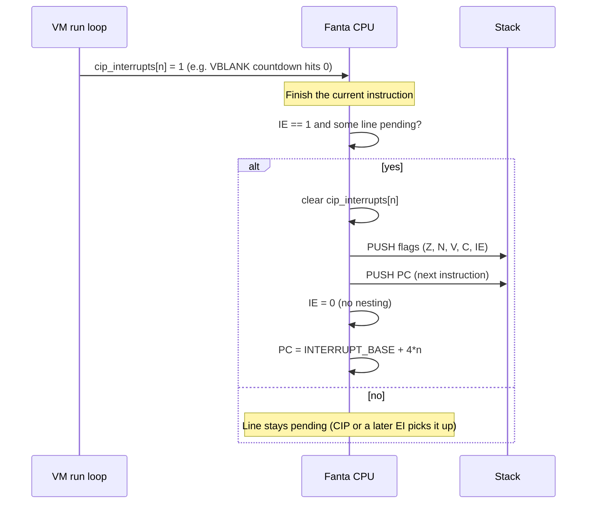

# Fanta ISA: Preemptive Interrupts Proposal

**Status:** proposal (rewritten 2026-10-17). The cooperative model (`CIP`) is already implemented.
This document proposes *preemptive* interrupts on top of it, fixes the opcode collision in the
earlier draft (EI/DI were assigned `0x1F`/`0x20`, which are already `CIP`/`BNC`), and states the
open design questions. See `docs/cooperative_interrupts.md` for the cooperative model and
`docs/reviews/2026-10-17-compiler-vm-full.md` for the review findings referenced here.

---

## 1. What exists today

| Piece | Where | Behaviour |
| :--- | :--- | :--- |
| Interrupt source | `vm/cpu.cpp` (`CYCLES_PER_FRAME = 50000`) | Every 50,000 executed instructions the VM sets `cip_interrupts[0] = 1` (the VBLANK line). |
| Pending lines | `CPU::cip_interrupts` | One pending flag per interrupt line. |
| `CIP #n` | opcode `0x1F`, `JUMP` format (26-bit field = line number) | If line `n` is pending: clear it, push PC, jump to `INTERRUPT_BASE + 4*n`. |
| Vector table | `Fanta::Info::Cpu::INTERRUPT_BASE = 0x100` | One 4-byte slot per line. |
| Handler return | `RET` | Pops the PC pushed by `CIP`. |

This is fully cooperative. A handler only runs when the program reaches a `CIP`, so a loop
without one locks out VBLANK. `cooperative_interrupts.md` covers compiler back-edge injection as
the mitigation.

**Known issues to resolve first.** Both are review findings:
- **B2:** SP starts at `0x7FFFFF`, so the first push overwrites VRAM pixel 0. Preemptive entry
  pushes two words with no warning to the program, so this must be fixed before any of the
  rest. Recommended: `STACK_TOP = VRAM_BASE - 4`.
- **B14:** the instruction counter that drives VBLANK is a file-scope global, so it is shared
  between CPU instances. It should be a per-CPU countdown (perf finding P1). That is also where
  the preemption check below belongs.

**Vector slot spacing.** Slots are 4 bytes, so the handler for line 0 at `0x100` already
overlaps line 1's slot at `0x104`. The demos (e.g. `test/vblank_bounce.asm`) put the whole ISR
body at `0x100`. Once there is more than one line, each slot has to hold a single `JMP` to the
real handler.

---

## 2. Models compared

| Model | Mechanism | CPU cost while idle | Latency | Cost to implement |
| :--- | :--- | :--- | :--- | :--- |
| Busy polling | Loop reading a flag | 100% | Depends on loop length | None |
| **Cooperative (today)** | `CIP` at chosen points | Low (`CIP` + `JMP` loop) | Until the next `CIP` | Done |
| **Preemptive (this proposal)** | VM checks pending lines at instruction boundaries when `IE = 1` | Low | Next instruction boundary | New flag, 3 instructions, entry/exit logic |

The two models can coexist. Preemption handles programs that run with `IE = 1`, and `CIP` keeps
working for code that runs with interrupts disabled. That includes everything written today,
because `IE` defaults to 0.

---

## 3. Entry flow

- **Where the check goes:** at the batch boundary of `run_cycles()` (P1), plus whenever `EI`
  executes. That keeps the hot loop free of a per-instruction branch. The cost is that
  preemption latency is bounded by the batch size, so the batch should stop at the next
  scheduled interrupt, as the P1 VBLANK countdown already does.
- **Priority:** the lowest pending line number wins.
- **Push order:** PC is pushed last, so it sits on top of the stack. `RETI` pops PC and then the
  flags.

---

## 4. State changes

- Add `IE` (Interrupt Enable) to the status flags. Today `status_reg` is a
  `std::array<std::uint8_t, 4>` indexed by raw `0..3`. With the flag enum from design finding D9,
  `IE` is one more enumerator, `{ ZERO, NEGATIVE, OVFL, CARRY, IE, COUNT }`.
- No separate `IP` (pending) bit is needed, because `cip_interrupts` already is the pending
  register.
- Flags are pushed as one packed word: bit 0 Z, bit 1 N, bit 2 V, bit 3 C, bit 4 IE.

---

## 5. New instructions

These use the first free opcodes after `BNC` (`0x20`). They have no operands and use the
existing `RET` format, the same one as `RET`/`NOP`. There is no `SINGLE` format.

| Instruction | Opcode | Format | Semantics |
| :--- | :--- | :--- | :--- |
| **EI** | `0x21` | `RET` (no operands) | `IE = 1`; then service any pending line immediately. |
| **DI** | `0x22` | `RET` (no operands) | `IE = 0`. |
| **RETI** | `0x23` | `RET` (no operands) | Pop PC, pop flags (restoring `IE`), continue. |

The opcode field is 6 bits wide (`<< 26`), so `0x21`–`0x3F` are free and these three fit.
Add the opcode-uniqueness `static_assert` from design finding D1 at the same time. It would have
rejected the earlier draft's `0x1F`/`0x20`.

---

## 6. Open questions

1. **Shared vector table, different return instructions.** A handler entered through `CIP`
   must end in `RET` (one word on the stack). A handler entered preemptively must end in `RETI`
   (two words). If both models can reach the same slot, one of them corrupts the stack.
   Options:
   - (a) A line is either cooperative or preemptive per program, by convention. This is the
     simplest option and needs no hardware support.
   - (b) A second vector base for preemptive entry (e.g. `INTERRUPT_BASE + 0x80`).
   - (c) Make `CIP` push flags too and return with `RETI`. This is uniform, but it changes
     existing demos.

   Recommendation: (a) for now, documented in the demos; revisit when a second line exists.
2. **Should `CIP` be a no-op while `IE = 1`?** Preemption would already have serviced the line,
   so `CIP` would only ever see lines raised since the last boundary. Leaving it as-is is
   harmless.
3. **Compiler back-edge injection** (`cooperative_interrupts.md`) only matters for `IE = 0` code.
   Is it still wanted once preemption exists, or only behind a flag?

---

## 7. Implementation checklist

Today an instruction touches several hand-synced lists (review D1). If the `FANTA_ISA` X-macro
lands first, steps 1–3 collapse to one row per instruction.

1. **ISA tables** (user): `*_INST` macros and `kInstructionTable` rows in
   `common/instructions.hpp`, with the hard-coded table size bumped; constants in
   `common/cpu_info.hpp`.
2. **Semantics** (user): `Ei`/`Di`/`Reti` exec structs in `vm/execute.hpp`; dispatch cases in `vm/cpu.cpp`; the
   boundary check in the run loop.
3. **Assembler** (user): `vm/string_assembler.hpp` RET-format path for the three mnemonics.
4. **Compiler** (user): `compiler/instruction_emit.cpp` cases, if the language exposes them.
   Note that `CIP` itself is not emitted today (review B20).
5. **Tools:** `tui/disasm.hpp` names; `fanta-trace`/`fanta-diff` should show `IE` toggles as
   flag mutations.
6. **Tests** (`test/cpu.cpp`):
   - `EI` with a line already pending enters the handler on the next instruction.
   - With `IE = 0`, a pending line stays pending and `CIP` still services it.
   - Entry pushes two words, and `RETI` restores PC, flags and `IE`, with SP balanced.
   - No nesting: a second pending line during the handler waits until `RETI`.
   - The stack never touches VRAM (the B2 test).
