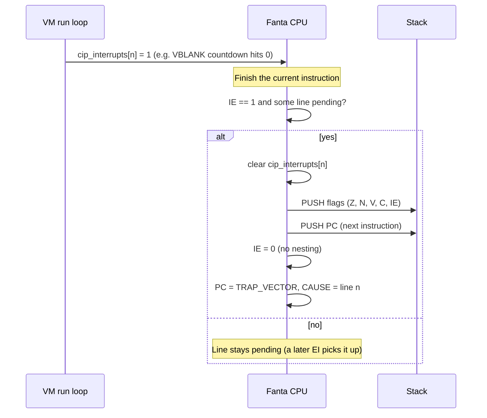

# Fanta ISA: Preemptive Interrupts Proposal

**Status:** proposal (rewritten 2026-10-17). This is the **kernel layer**: hardware interrupts
taken preemptively by the CPU, and later the same entry path for syscalls (`SYS`) and faults.
The cooperative model (`CIP`) is a separate **user layer**, specified in
`docs/cooperative_interrupts.md`. The two layers share only the pending bits (§2). This document
also fixes the opcode collision in the earlier draft (EI/DI were assigned `0x1F`/`0x20`, which
are already `CIP`/`BNC`). See `docs/reviews/2026-10-17-compiler-vm-full.md` for the review
findings referenced here.

---

## 1. What exists today

| Piece | Where | Behaviour |
| :--- | :--- | :--- |
| Interrupt source | `vm/cpu.cpp` (`CYCLES_PER_FRAME = 50000`) | Every 50,000 executed instructions the VM sets `cip_interrupts[0] = 1` (the VBLANK line). |
| Pending lines | `CPU::cip_interrupts` | One pending flag per interrupt line. |
| `CIP` | opcode `0x1F` | User-layer event delivery. Specified (with a new line + handler-offset encoding, still to be implemented) in `docs/cooperative_interrupts.md`. |

There is no kernel layer yet: nothing is ever taken preemptively, and a VBLANK only has an
effect when the program reaches a `CIP`.

**Known issues to resolve first:**
- **B2 (fixed):** SP now starts at `0x7FFFFC`, the top word below VRAM, so stack pushes no longer
  overwrite pixel 0.
- **B14:** the instruction counter that drives VBLANK is a file-scope global, so it is shared
  between CPU instances. It should be a per-CPU countdown (perf finding P1). That is also where
  the preemption check below belongs.

---

## 2. Models compared

| Model | Mechanism | CPU cost while idle | Latency | Cost to implement |
| :--- | :--- | :--- | :--- | :--- |
| Busy polling | Loop reading a flag | 100% | Depends on loop length | None |
| **Cooperative (today)** | `CIP` at chosen points | Low (`CIP` + `JMP` loop) | Until the next `CIP` | Done |
| **Preemptive (this proposal)** | VM checks pending lines at instruction boundaries when `IE = 1` | Low | Next instruction boundary | New flag, 3 instructions, entry/exit logic |

These are layers, not competing models:

- **Kernel layer (this proposal):** a device raises a line; if `IE = 1` the CPU enters the
  kernel's trap handler at the next boundary. Later, `SYS` and faults use the same entry.
- **User layer (`CIP`):** a program's registered handlers run at safe points it chooses, as
  ordinary function calls that return with `RET`.
- **Where they meet:** `cip_interrupts[]`, the pending bits. Today the VM sets them directly,
  acting as a null kernel. With an OS, the kernel takes the hardware interrupt and then marks
  the event pending for the process, as with a Unix signal.

`IE` defaults to 0, so everything written today keeps working unchanged.

---

## 3. Entry flow

- **Where the check goes:** at the batch boundary of `run_cycles()` (P1), plus whenever `EI`
  executes. That keeps the hot loop free of a per-instruction branch. The cost is that
  preemption latency is bounded by the batch size, so the batch should stop at the next
  scheduled interrupt, as the P1 VBLANK countdown already does.
- **Priority:** the lowest pending line number wins.
- **One vector plus a cause:** entry jumps to a single kernel `TRAP_VECTOR` and records the reason
  (here, the line number) in a cause register, so syscalls and faults can reuse the same entry.
  This is separate from `CIP`, which has no vector table at all (its handler is encoded in the
  instruction). `INTERRUPT_BASE` (`0x100`) goes away once `CIP` is migrated.
- **Clearing the line:** when the kernel takes a hardware interrupt it clears the hardware
  pending state. Whether, and when, it then raises the user-layer event is the kernel's
  decision. Pre-OS, the two are the same bit.
- **Push order:** PC is pushed last, so it sits on top of the stack. `RETI` pops PC and then the
  flags.

---

## 4. State changes

- Add `IE` (Interrupt Enable) to the status flags. Today `status_reg` is a
  `std::array<std::uint8_t, 4>` indexed by raw `0..3`. With the flag enum from design finding D9,
  `IE` is one more enumerator, `{ ZERO, NEGATIVE, OVFL, CARRY, IE, COUNT }`.
- No separate `IP` (pending) bit is needed, because `cip_interrupts` already is the pending
  register.
- Flags are pushed as one packed word: bit 0 Z, bit 1 N, bit 2 V, bit 3 C, bit 4 IE.

---

## 5. New instructions

These use the first free opcodes after `BNC` (`0x20`). They have no operands and use the
existing `RET` format, the same one as `RET`/`NOP`. There is no `SINGLE` format.

| Instruction | Opcode | Format | Semantics |
| :--- | :--- | :--- | :--- |
| **EI** | `0x21` | `RET` (no operands) | `IE = 1`; then service any pending line immediately. |
| **DI** | `0x22` | `RET` (no operands) | `IE = 0`. |
| **RETI** | `0x23` | `RET` (no operands) | Pop PC, pop flags (restoring `IE`), continue. |

The opcode field is 6 bits wide (`<< 26`), so `0x21`–`0x3F` are free and these three fit.
Add the opcode-uniqueness `static_assert` from design finding D1 at the same time. It would have
rejected the earlier draft's `0x1F`/`0x20`.

---

## 6. Open questions

1. **Resolved: shared vector table, different return instructions.** The earlier draft had
   `CIP` and preemptive entry sharing the `0x100` slots, which would have mixed `RET` handlers
   (one word on the stack) with `RETI` handlers (two words). With the two-layer model they never
   share an entry point: `CIP` handlers are user functions returning with `RET`, and the
   preemptive path enters the kernel's `TRAP_VECTOR` and returns with `RETI`.
2. **`RETI` or a general `ERET`?** Once `SYS` and faults share the entry, "return from
   interrupt" becomes "return from exception". Name and semantics are the same; renaming before
   implementation is free.
3. **Pre-OS, does preemption deliver to user code?** Until a kernel exists, the program running
   with `IE = 1` *is* the kernel, so its trap handler is the program's own code. That's fine, but
   it means the first programs to enable `IE` must be written as trap handlers (save and restore
   everything, end in `RETI`), not as `CIP` handlers.
4. **Mode bit and kernel stack:** an OS will need a user/kernel mode bit and a separate kernel SP
   on entry. Decide whether to reserve the status bit now even while everything runs in kernel
   mode.

---

## 7. Implementation checklist

Today an instruction touches several hand-synced lists (review D1). If the `FANTA_ISA` X-macro
lands first, steps 1–3 collapse to one row per instruction.

1. **ISA tables** (user): `*_INST` macros and `kInstructionTable` rows in
   `common/instructions.hpp`, with the hard-coded table size bumped; constants in
   `common/cpu_info.hpp`.
2. **Semantics** (user): `Ei`/`Di`/`Reti` exec structs in `vm/execute.hpp`; dispatch cases in `vm/cpu.cpp`; the
   boundary check in the run loop.
3. **Assembler** (user): `vm/string_assembler.hpp` RET-format path for the three mnemonics.
4. **Compiler** (user): `compiler/instruction_emit.cpp` cases, if the language exposes them.
   Note that `CIP` itself is not emitted today (review B20).
5. **Tools:** `tui/disasm.hpp` names; `fanta-trace`/`fanta-diff` should show `IE` toggles as
   flag mutations.
6. **Tests** (`test/cpu.cpp`):
   - `EI` with a line already pending enters the handler on the next instruction.
   - With `IE = 0`, a pending line stays pending and `CIP` still services it (user layer).
   - Entry pushes two words, and `RETI` restores PC, flags and `IE`, with SP balanced.
   - No nesting: a second pending line during the handler waits until `RETI`.
   - The stack never touches VRAM (already covered by the B2 tests).
