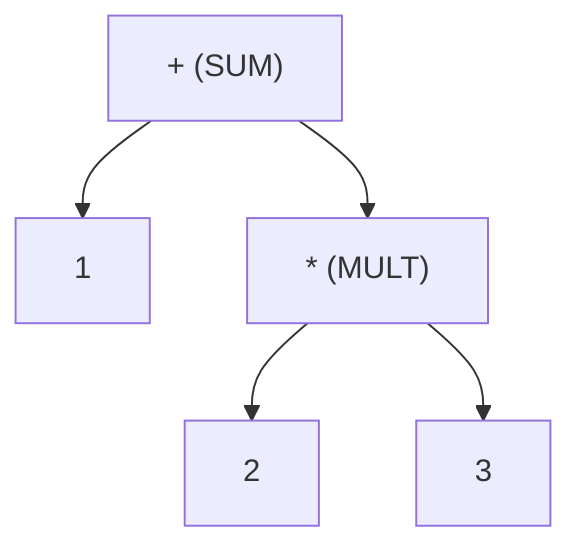

# Pratt Parsing in Fanta

This document explains how the **Pratt Parser** (Top-Down Operator Precedence parser) works in Fanta, using the implementation in [parser.hpp](file:///Users/paul-julesmicolet/Code/fanta/compiler/parser.hpp) as the reference.

---

## 1. What is Pratt Parsing?

A traditional recursive-descent parser requires a separate grammar function for each level of operator precedence (e.g., `parsePrimary`, `parseUnary`, `parseMul`, `parseAdd`). This leads to deep call stacks and verbose boilerplates.

A **Pratt Parser** associates precedence values and parsing functions directly with tokens:
- **Prefix parsing** (`walkPrefix()`): Handles terminals (numbers, variables) and prefix operators (like `-` or `!`).
- **Infix parsing** (`walkInfix()`): Handles binary operators (like `+`, `*`) and postfix or mixfix operators (like function calls `(`, subscripts `[`).
- **Binding Power** (`Precedence`): Dictates which operator binds more tightly to its operand.

---

## 2. Core Components in Fanta

### `Precedence` Enum
Precedence is defined on a scale from lowest to highest.
```cpp
enum class Precedence : uint8_t {
  LOWEST = 0,
  ASSIGN_OR_RET = 1,
  SUM = 2,
  MINUS = 2,
  MULT = 3,
  DIVIDE = 3,
  CALL = 4
};
```

### `walkExpression(Precedence p)`
This is the driver of the parser. It takes the current context's precedence limit `p` and returns the index of the parsed expression node:

```cpp
auto walkExpression(Precedence p) -> Fanta::AST::NodeIndex {
  auto prefix = walkPrefix();

  while (p < getPrecedence(currentToken.t)) {
    auto current = currentToken;
    nextToken();
    prefix = walkInfix(prefix, current);
  }
  return prefix;
}
```

1. **Start with Prefix**: It first parses whatever terminal or prefix operator starts the expression (e.g., a number literal or variable).
2. **Loop on Precedence**: As long as the next token has a higher precedence than the current context's limit `p`, the loop continues.
3. **Consume & Nest**: It consumes the operator, calls `walkInfix()`, and wraps the current `prefix` node as the left-hand side of a new expression.

---

## 3. Step-by-Step Traces

### Example A: `1 + 2 * 3`
Let's parse `1 + 2 * 3` starting with `walkExpression(Precedence::LOWEST)`:



1. **`walkExpression(LOWEST)`** is called:
   - `walkPrefix()` parses `1` and returns its AST node index.
   - Next token is `+` (Precedence `SUM` = 2).
   - Since `LOWEST` (0) < `SUM` (2), we loop:
     - Consume `+`.
     - Call `walkInfix(idx_1, +)`.
       - Inside `walkInfix`:
         - Calls **`walkExpression(SUM)`** to parse the right-hand side.
           - `walkPrefix()` parses `2` and returns its index.
           - Next token is `*` (Precedence `MULT` = 3).
           - Since the current limit is `SUM` (2) and `SUM` (2) < `MULT` (3), the loop runs:
             - Consume `*`.
             - Call `walkInfix(idx_2, *)`.
               - Inside `walkInfix`:
                 - Calls **`walkExpression(MULT)`** for the RHS.
                   - `walkPrefix()` parses `3` and returns its index.
                   - Next token is `;` (Precedence `LOWEST` = 0).
                   - Since `MULT` (3) is not less than `LOWEST` (0), the loop does not run.
                   - Returns `idx_3`.
                 - `walkInfix` constructs `2 * 3` and returns its node index (`idx_mult`).
           - The loop in `walkExpression(SUM)` ends because next token is `;` (`SUM` is not less than `LOWEST`).
           - Returns `idx_mult`.
       - `walkInfix(idx_1, +)` constructs `1 + (2 * 3)` and returns its index (`idx_plus`).
   - Loop in `walkExpression(LOWEST)` ends. Returns `idx_plus`.

---

### Example B: `1 + 2 + 3` (Left Associativity)
Left-associative operators are resolved because the recursion limit is equal to the operator's precedence.

1. **`walkExpression(LOWEST)`**:
   - `walkPrefix()` parses `1`.
   - Next token is `+` (Precedence `SUM` = 2).
   - Loop runs:
     - Consume `+`.
     - Calls `walkInfix(idx_1, +)`.
       - Inside `walkInfix`:
         - Calls **`walkExpression(SUM)`** for the RHS.
           - `walkPrefix()` parses `2`.
           - Next token is `+` (Precedence `SUM` = 2).
           - Since the limit `SUM` (2) is **not less** than the next token's precedence `SUM` (2) (`2 < 2` is false), the loop does not run!
           - Returns `idx_2`.
       - `walkInfix` returns the index of `1 + 2` (`idx_plus1`).
   - Loop in `walkExpression(LOWEST)` continues because the next token is still `+` and `LOWEST` (0) < `SUM` (2):
     - Consume `+`.
     - Call `walkInfix(idx_plus1, +)`.
       - Inside `walkInfix`:
         - Calls **`walkExpression(SUM)`** for the RHS, which parses `3`.
       - `walkInfix` returns the index of `(1 + 2) + 3`.
   - Returns the final index.

---

### Example C: `foo(a, b)` (Function Calls as Infix)
In Pratt parsing, the open parenthesis `(` can be treated as an infix operator when it follows an expression.

1. **`walkExpression(LOWEST)`**:
   - `walkPrefix()` parses the identifier `foo`.
   - Next token is `(` (Precedence `CALL` = 4).
   - Since `LOWEST` (0) < `CALL` (4), we loop:
     - Consume `(`.
     - Call `walkInfix(idx_foo, ()`.
       - Inside `walkInfix` (specialized branch for `OpenParam`):
         - Loops to parse arguments separated by commas using `walkExpression(LOWEST)` for each parameter.
         - Parses `a` and `b`.
         - Expects `)`.
         - Constructs a `FunctionCall` node with `foo` as the callee and `[a, b]` as parameters.
       - Returns `idx_call`.
   - Returns `idx_call`.

---

## 4. Proposed Doxygen Comments

Below is the exact diff to add structured documentation to the Pratt parsing functions in `compiler/parser.hpp`. Since `compiler/` is a user-owned directory, you should apply this diff directly.

```diff
diff --git a/compiler/parser.hpp b/compiler/parser.hpp
index b61c3ef..4fd2cb2 100644
--- a/compiler/parser.hpp
+++ b/compiler/parser.hpp
@@ -272,3 +272,17 @@ private:
 
+  /**
+   * @brief The core driver of the Pratt Parser. Recursively parses expressions based on binding power.
+   * 
+   * @details First calls walkPrefix() to parse the immediate leading token (e.g., a literal or identifier).
+   *          Then, loops as long as the next token has a higher precedence than the current limit `p`.
+   *          During each iteration, the operator is consumed and passed to walkInfix() along with the
+   *          expression parsed so far to form a nested binary operator or function call node.
+   * 
+   * @note Left-associative operators are naturally handled because walkExpression passes the operator's
+   *       own precedence value as the limit for the right-hand side, stopping at equal-precedence operators.
+   * 
+   * @param p The precedence limit (binding power threshold) for the current recursive context.
+   * @return The AST index of the parsed expression.
+   */
   auto walkExpression(Precedence p) -> Fanta::AST::NodeIndex {
     auto prefix = walkPrefix();
 
     while (p < getPrecedence(currentToken.t)) {
       auto current = currentToken;
       nextToken();
       prefix = walkInfix(prefix, current);
     }
     return prefix;
   }
 
+  /**
+   * @brief Parses infix and postfix expressions (binary operators and function calls).
+   * 
+   * @details Invoked by walkExpression when an operator token with higher precedence than the current
+   *          limit is encountered.
+   *          - For binary operators (e.g., '+', '*'), it recursively parses the right-hand side with the
+   *            operator's own precedence limit, ensuring correct left-associative or right-nested binding.
+   *          - For '(', it handles function calls, parsing a comma-separated list of arguments.
+   * 
+   * @param idx The AST index of the already parsed left-hand side expression.
+   * @param t The operator or calling token.
+   * @return The AST index of the newly constructed expression node.
+   */
   auto walkInfix(Fanta::AST::NodeIndex idx, Lexer::Token t)
       -> Fanta::AST::NodeIndex {
     if (t.t == Lexer::TokenType::OpenParam) {
       std::vector<Fanta::AST::NodeIndex> args;
       while (currentToken.t != Lexer::TokenType::CloseParam) {
         auto expr = walkExpression(Precedence::LOWEST);
         args.push_back(expr);
         auto c = expect(Lexer::TokenType::Comma);
       }
       auto b = expect(Lexer::TokenType::CloseParam);
       Fanta::AST::FunctionCall fc{idx, args};
       asts.push_back({fc, 0});
       return asts.size() - 1;
     } else {
       auto rhsExpr = walkExpression(getPrecedence(t.t));
       Fanta::AST::BinaryOperator op{idx, rhsExpr, t.t};
       asts.push_back({op, 0});
       return asts.size() - 1;
     }
   }
 
+  /**
+   * @brief Parses prefix expressions and terminals (identifiers, integer literals).
+   * 
+   * @details These are valid start tokens for an expression. Currently supports identifiers,
+   *          integers, and skips semicolons.
+   * 
+   * @return The AST index of the parsed terminal or prefix operator. Returns -1 on invalid start tokens.
+   */
   auto walkPrefix() -> Fanta::AST::NodeIndex {
     switch (currentToken.t) {
     case Lexer::TokenType::Identifier: {
       EXTRACT_TOKEN_TO_VAR_WRET(rhsIdentifier, Lexer::TokenType::Identifier,
                                 -1);
       Fanta::AST::Identifier id{rhsIdentifier->lexeme};
       asts.push_back({id, 0});
       return asts.size() - 1;
     }
     case Lexer::TokenType::IntLiteral: {
       EXTRACT_TOKEN_TO_VAR_WRET(rhsLiteral, Lexer::TokenType::IntLiteral, -1);
       int val = 0;
       std::from_chars(rhsLiteral->lexeme.data(),
                       rhsLiteral->lexeme.data() + rhsLiteral->lexeme.size(),
                       val);
       Fanta::AST::IntLiteral id{val};
       asts.push_back({id, 0});
       return asts.size() - 1;
     }
     case Lexer::TokenType::SemiColon: {
       return -1;
     }
     default:
       return -1;
     }
   }
 
+  /**
+   * @brief Retrieves the operator precedence (binding power) for a given token type.
+   * 
+   * @details Higher values indicate stronger binding power. This determines how
+   *          operators group together in expressions (e.g. MULT binds stronger than SUM).
+   * 
+   * @param t The token type to look up.
+   * @return The corresponding Precedence enum value.
+   */
   auto getPrecedence(Lexer::TokenType t) -> Precedence {
```
