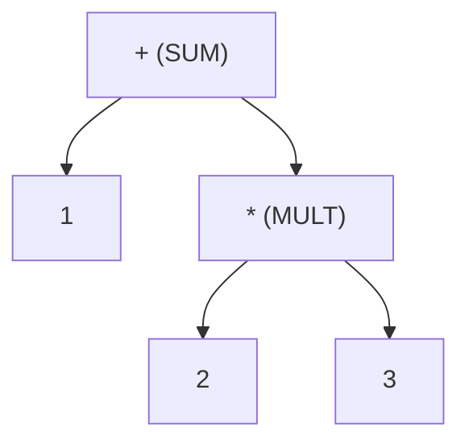

# Pratt Parsing in Fanta

This document explains how the **Pratt Parser** (Top-Down Operator Precedence parser) works in Fanta, using the implementation in `compiler/parser.cpp` as the reference. `docs/parser.md` has the full precedence table and grammar.

---

## 1. What is Pratt Parsing?

A traditional recursive-descent parser requires a separate grammar function for each level of operator precedence (e.g., `parsePrimary`, `parseUnary`, `parseMul`, `parseAdd`). This leads to deep call stacks and verbose boilerplates.

A **Pratt Parser** associates precedence values and parsing functions directly with tokens:
- **Prefix parsing** (`walkPrefix()`): Handles terminals (numbers, variables) and prefix operators (like `-` or `!`).
- **Infix parsing** (`walkInfix()`): Handles binary operators (like `+`, `*`) and postfix or mixfix operators (like function calls `(`, subscripts `[`).
- **Binding Power** (`Precedence`): Dictates which operator binds more tightly to its operand.

---

## 2. Core Components in Fanta

### `Precedence` Enum
Precedence is defined on a scale from lowest to highest.
```cpp
enum class Precedence : uint8_t {
  LOWEST = 0,
  IFELSE = 1,
  ASSIGN_OR_RET = 2,
  LOGIC = 3,
  BITWISE = 4,
  COMP = 5,
  SUM = 6,
  MINUS = 6,
  MULT = 7,
  DIVIDE = 7,
  CALL = 8,
};
```

### `walkExpression(Precedence p)`
This is the driver of the parser. It takes the current context's precedence limit `p` and returns the index of the parsed expression node:

```cpp
auto walkExpression(Precedence p) -> Fanta::AST::NodeIndex {
  auto prefix = walkPrefix();

  while (p < getPrecedence(currentToken.t)) {
    auto current = currentToken;
    nextToken();
    prefix = walkInfix(prefix, current);
  }
  return prefix;
}
```

1. **Start with Prefix**: It first parses whatever terminal or prefix operator starts the expression (e.g., a number literal or variable).
2. **Loop on Precedence**: As long as the next token has a higher precedence than the current context's limit `p`, the loop continues.
3. **Consume & Nest**: It consumes the operator, calls `walkInfix()`, and wraps the current `prefix` node as the left-hand side of a new expression.

---

## 3. Step-by-Step Traces

### Example A: `1 + 2 * 3`
Let's parse `1 + 2 * 3` starting with `walkExpression(Precedence::LOWEST)`:



1. **`walkExpression(LOWEST)`** is called:
   - `walkPrefix()` parses `1` and returns its AST node index.
   - Next token is `+` (Precedence `SUM` = 6).
   - Since `LOWEST` (0) < `SUM` (6), we loop:
     - Consume `+`.
     - Call `walkInfix(idx_1, +)`.
       - Inside `walkInfix`:
         - Calls **`walkExpression(SUM)`** to parse the right-hand side.
           - `walkPrefix()` parses `2` and returns its index.
           - Next token is `*` (Precedence `MULT` = 7).
           - Since the current limit is `SUM` (6) and `SUM` (6) < `MULT` (7), the loop runs:
             - Consume `*`.
             - Call `walkInfix(idx_2, *)`.
               - Inside `walkInfix`:
                 - Calls **`walkExpression(MULT)`** for the RHS.
                   - `walkPrefix()` parses `3` and returns its index.
                   - Next token is `;` (Precedence `LOWEST` = 0).
                   - Since `MULT` (7) is not less than `LOWEST` (0), the loop does not run.
                   - Returns `idx_3`.
                 - `walkInfix` constructs `2 * 3` and returns its node index (`idx_mult`).
           - The loop in `walkExpression(SUM)` ends because next token is `;` (`SUM` is not less than `LOWEST`).
           - Returns `idx_mult`.
       - `walkInfix(idx_1, +)` constructs `1 + (2 * 3)` and returns its index (`idx_plus`).
   - Loop in `walkExpression(LOWEST)` ends. Returns `idx_plus`.

---

### Example B: `1 + 2 + 3` (Left Associativity)
Left-associative operators are resolved because the recursion limit is equal to the operator's precedence.

1. **`walkExpression(LOWEST)`**:
   - `walkPrefix()` parses `1`.
   - Next token is `+` (Precedence `SUM` = 6).
   - Loop runs:
     - Consume `+`.
     - Calls `walkInfix(idx_1, +)`.
       - Inside `walkInfix`:
         - Calls **`walkExpression(SUM)`** for the RHS.
           - `walkPrefix()` parses `2`.
           - Next token is `+` (Precedence `SUM` = 6).
           - Since the limit `SUM` (6) is **not less** than the next token's precedence `SUM` (6) (`6 < 6` is false), the loop does not run!
           - Returns `idx_2`.
       - `walkInfix` returns the index of `1 + 2` (`idx_plus1`).
   - Loop in `walkExpression(LOWEST)` continues because the next token is still `+` and `LOWEST` (0) < `SUM` (6):
     - Consume `+`.
     - Call `walkInfix(idx_plus1, +)`.
       - Inside `walkInfix`:
         - Calls **`walkExpression(SUM)`** for the RHS, which parses `3`.
       - `walkInfix` returns the index of `(1 + 2) + 3`.
   - Returns the final index.

---

### Example C: `foo(a, b)` (Function Calls as Infix)
In Pratt parsing, the open parenthesis `(` can be treated as an infix operator when it follows an expression.

1. **`walkExpression(LOWEST)`**:
   - `walkPrefix()` parses the identifier `foo`.
   - Next token is `(` (Precedence `CALL` = 8).
   - Since `LOWEST` (0) < `CALL` (8), we loop:
     - Consume `(`.
     - Call `walkInfix(idx_foo, ()`.
       - Inside `walkInfix` (specialized branch for `OpenParam`):
         - Loops to parse arguments separated by commas using `walkExpression(LOWEST)` for each parameter.
         - Parses `a` and `b`.
         - Expects `)`.
         - Constructs a `FunctionCall` node with `foo` as the callee and `[a, b]` as parameters.
       - Returns `idx_call`.
   - Returns `idx_call`.
